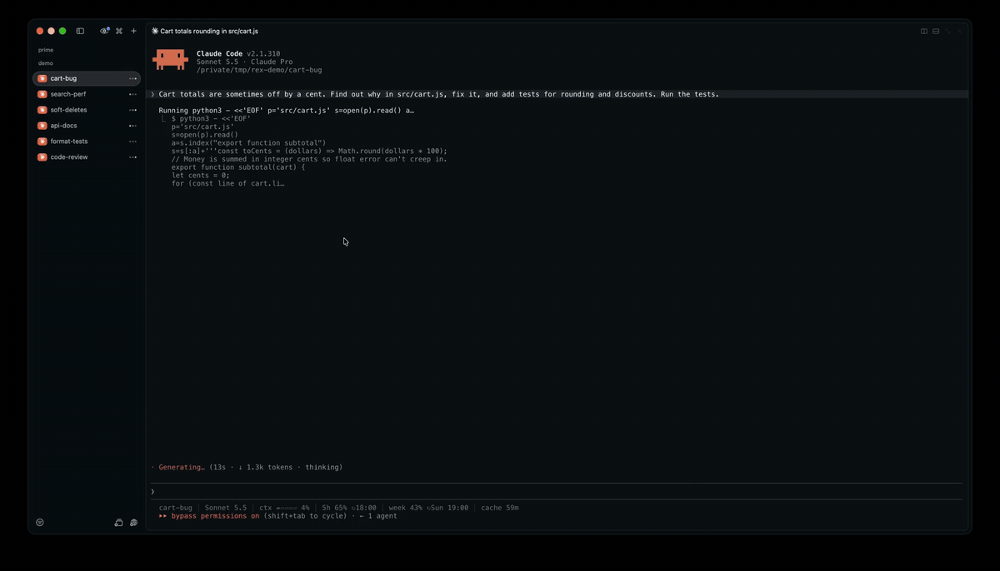

# rex-agent-kit

Small tools for running a lot of coding agents in [Rex](https://www.superlogical.com/rex), one tab each.



- **Agent Wall** (`Cmd+Shift+A`): every tab of the session you're looking at, tiled into one grid tab, so you can
  watch all your agents work at once. Press it again and each one goes back to its own tab, named as before. Nothing
  restarts: Rex moves the panes, and the programs in them keep running.
- **New Claude** (`Cmd+Shift+C`): a new tab with Claude Code started, in the session you're looking at, so `Cmd+1…9`
  switches between your agents.

## Install

Needs Rex, `bash` and `jq` (macOS 15 and later ship `jq` in `/usr/bin`).

```sh
git clone https://github.com/theJiawen/rex-agent-kit ~/code/rex-agent-kit
ln -s ~/code/rex-agent-kit/lua ~/.config/rex/agent-kit
ln -s ~/code/rex-agent-kit/bin/rex-wall ~/.local/bin/rex-wall   # optional: the wall from a shell too
```

Then add to `~/.config/rex/init.lua`:

```lua
require("agent-kit.wall"){ key = "cmd+shift+a" }
require("agent-kit.new-claude"){ key = "cmd+shift+c" }
```

and run `rex config check && rex config reload`. Both also show in the command palette.

## Install with your agent

Paste this to Claude Code, Codex or any agent with a shell:

```text
Install https://github.com/theJiawen/rex-agent-kit for me
```

### Steps for the agent

1. Check that `rex` and `jq` run (`rex version`, `jq --version`). Without Rex, stop and say so.
2. Clone the repo to `~/code/rex-agent-kit`, or `git pull` if it's already there.
3. Link `lua/` into Rex's config folder (`$XDG_CONFIG_HOME/rex`, else `~/.config/rex`) as `agent-kit`, and, if
   `~/.local/bin` is on `PATH`, `bin/rex-wall` into it. If either path exists and isn't this link, ask before
   replacing it.
4. Run `rex keymap`. If `shift+cmd+a` or `shift+cmd+c` is already bound, ask which key to use instead.
5. Add the two `require` lines above to `init.lua` (create it if missing). Add only what isn't there, and leave the
   rest of the file as it is.
6. Run `rex config check`, then `rex config reload`. On an error, show it and take your lines out again.
7. Confirm with `rex actions | grep -E 'agent_wall|new_claude'`, and tell the person their keys.

### Using it from an agent

- `rex-wall` toggles the wall for the session the agent runs in (`REX_SESSION`); `-s SESSION` picks another.
- `rex-wall --dry-run` shows the grid it would make without moving anything.
- `rex do -s SESSION agent_wall` does the same through Rex, when `rex-wall` isn't on `PATH`.

## Agent Wall

The grid is rows of near-equal length, wider than tall: 4 tabs make 2×2, 6 make 2×3, 7 make 4 + 3. Each pane takes
its tab's name while it's on the wall. A tab that was already split comes back split side by side. An agent that
exits while on the wall is skipped on the way back. The tab names and order are kept in `~/.local/state/rex-wall/`
while the wall is up.

From a shell:

```sh
rex-wall              # toggle
rex-wall on | off
rex-wall -s SESSION   # default: the session you're in, or the only one
rex-wall --dry-run    # show the grid, change nothing
```

While the wall is up, `Cmd+1…9` has one tab to switch to: click a pane, or zoom one. New tabs you open meanwhile
stay their own tabs.

## New Claude

```lua
require("agent-kit.new-claude"){
  key     = "cmd+shift+c",
  dir     = "~/code/my-project",  -- default: where the pane you pressed it in is
  session = "work",               -- used (or made) when no session is shown; default "claude"
  command = "claude",             -- typed into a login shell, so aliases work; "codex" works too
  label   = "claude",             -- the new tab's name
}
```

Call it more than once with a different `name` (and `title`) for one key per project.

## Record a demo

`demo/start.sh` opens a Rex session of 6 Claude Code agents, each on a real task in its own copy of a small store
project under `/tmp/rex-demo` (permission prompts off, on Sonnet), so a recording shows none of your own work. The
tasks go out 15 seconds after it starts, so you can start recording first. `demo/start.sh --stand-ins` uses
make-believe agents instead (no Claude), and `demo/start.sh --stop` closes it and puts the app back.

## License

MIT
